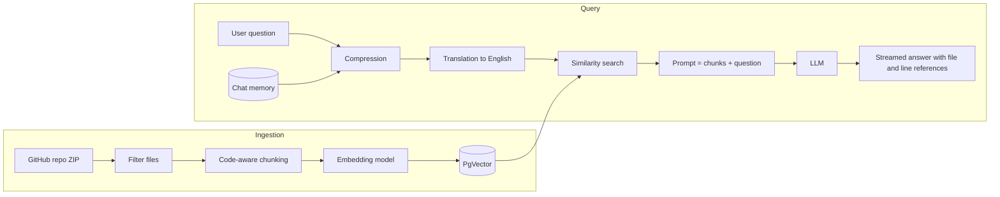

# RepoMind

**Chat with any public GitHub repository.** RepoMind downloads a repo, splits its code into meaningful chunks, stores them in a PostgreSQL vector database (PgVector), and answers your questions with a Retrieval-Augmented Generation (RAG) pipeline built on Spring AI. Every answer can point back to the file and line numbers it came from.

> Ask in English or Urdu: *"Where is user login handled in this repo?"* or *"اس repo میں authentication کہاں ہوتی ہے؟"*

---

## Features

- **Load any public repo** by `owner`, `repo` and `branch`. The repo is fetched as a single ZIP, so no GitHub token or API rate limits are needed.
- **Smart file filtering.** Skips `.git`, `node_modules`, `target`, `build`, lock files, minified files, binaries and files larger than 200 KB.
- **Code-aware chunking.** Files are split at logical boundaries (classes, methods, functions, headings) instead of blindly every N tokens. Supports Java, Kotlin, JavaScript, TypeScript, Python, HTML, CSS, XML, JSON, YAML, SQL and Markdown.
- **Line numbers in every chunk.** Each chunk stores `path`, `startLine` and `endLine`, so answers can cite exact locations.
- **Advanced RAG pipeline** with Spring AI:
  - `CompressionQueryTransformer`: turns follow-up questions into standalone questions using chat history.
  - `TranslationQueryTransformer`: translates Urdu questions to English before searching.
  - `VectorStoreDocumentRetriever` with similarity threshold and top-K.
- **Conversation memory** stored in PostgreSQL (JDBC chat memory), per `userId`.
- **Streaming responses** (Server-Sent style `Flux<String>`) for a fast, chat-like feel.
- **Re-loadable.** Loading the same repo again replaces its old chunks, so there are no duplicates.

---

## How it works



**Ingestion (done once per repo)**

1. Download `https://codeload.github.com/{owner}/{repo}/zip/refs/heads/{branch}`.
2. Read each file from the ZIP and keep only useful text and code files.
3. Split each file into chunks (blocks of related code, about 2000 characters at most).
4. Add metadata: `repo`, `path`, `extension`, `startLine`, `endLine`.
5. Create embeddings and save everything in PgVector.

**Query (every question)**

1. Load the conversation history for the `userId`.
2. Rewrite the question so it stands on its own, then translate it to English.
3. Find the most similar chunks in the vector store.
4. Send the chunks and the question to the LLM and stream the answer back.

---

## Tech stack

| Area | Technology |
|---|---|
| Language | Java 21 |
| Framework | Spring Boot, Spring AI |
| Vector store | PostgreSQL + PgVector |
| Chat memory | Spring AI JDBC chat memory |
| LLMs | OpenAI-compatible chat model, Google Gemini (GenAI) |
| HTTP client | Spring `RestClient` |
| Build tool | Maven (wrapper included) |

---

## Getting started

### Prerequisites

- Java 21 or newer
- PostgreSQL with the [pgvector](https://github.com/pgvector/pgvector) extension enabled
- An API key for your chat and embedding provider(s)

### 1. Clone

```bash
git clone https://github.com/Muhammadharis786/RepoMind.git
cd RepoMind
```

### 2. Set up the database

```sql
CREATE DATABASE repomind;
\c repomind
CREATE EXTENSION IF NOT EXISTS vector;
```

Spring AI can create the vector table and the chat-memory table for you if schema initialization is enabled in your configuration.

### 3. Configure environment variables

**Never commit real API keys.** Keep them in environment variables (or in an ignored `application-local.properties`).

```properties
# application.properties (placeholders only)
spring.datasource.url=${DB_URL}
spring.datasource.username=${DB_USERNAME}
spring.datasource.password=${DB_PASSWORD}

spring.ai.openai.api-key=${OPENAI_API_KEY}
spring.ai.openai.base-url=${OPENAI_BASE_URL}

spring.ai.google.genai.api-key=${GOOGLE_API_KEY}
```

Set them in your shell, for example:

```bash
export DB_URL=jdbc:postgresql://localhost:5432/repomind
export DB_USERNAME=postgres
export DB_PASSWORD=your_password
export OPENAI_API_KEY=your_key
export GOOGLE_API_KEY=your_key
```

Property names can differ between Spring AI versions, so check the Spring AI documentation for the version you use.

### 4. Run

```bash
./mvnw spring-boot:run
```

On Windows use `mvnw.cmd spring-boot:run`.

---

## Usage

### Load a repository

```bash
curl -X POST "http://localhost:8080/repo/load?owner=spring-projects&repo=spring-petclinic&branch=main"
```

Example console output:

```
Downloading: https://codeload.github.com/spring-projects/spring-petclinic/zip/refs/heads/main
Files found: 60, chunks created: 150
Saved 50 / 150
...
```

> Some repos use `master` instead of `main`. If you get a 404, check the default branch name on GitHub.

### Ask a question

Send your question and a `userId` to the chat endpoint. The `userId` is the conversation id used for chat memory.

Example questions:

- *Where is the owner data saved in this repo?*
- *Which class handles validation?*
- *Explain how the project is structured.*
- *And where is it tested?* (follow-up questions work thanks to query compression)

---

## Project structure

```
src/main/java/com/haris/reporead/
├── Controller/          # REST endpoints (load repo, chat)
└── Service/
    ├── RepoService.java   # ZIP download, file filtering, RAG chat
    └── CodeChunker.java   # Code-aware chunking with line numbers
```

---

## Roadmap

- [ ] AST-based chunking for Java using JavaParser (one method = one chunk)
- [ ] Tree-sitter support for more languages
- [ ] File-level and folder-level summaries for high-level questions
- [ ] Auto-generated Mermaid architecture diagrams
- [ ] Support for private repositories with a GitHub token
- [ ] Web UI with chat and repo management
- [ ] Re-sync a repo when new commits are pushed

---

## Known limitations

- Chunking is regex-based, not a full parser. Unusual or minified code may be split imperfectly.
- Very large repos take time and use many embedding API calls. Start with a small repo.
- Only public repositories are supported for now.

---

## Contributing

Issues and pull requests are welcome. For major changes, please open an issue first to discuss what you would like to change.

## Author

**Muhammad Haris**, Computer Science graduate, Karachi, Pakistan.
GitHub: [@Muhammadharis786](https://github.com/Muhammadharis786)
